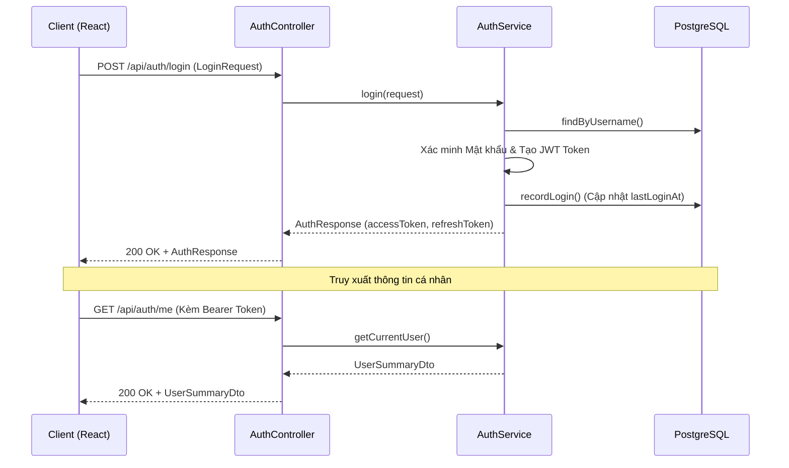
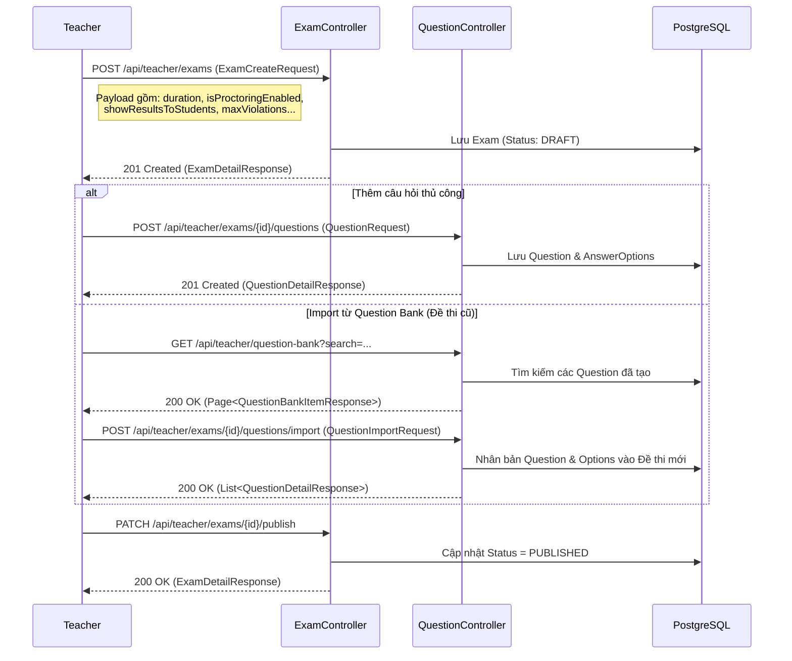
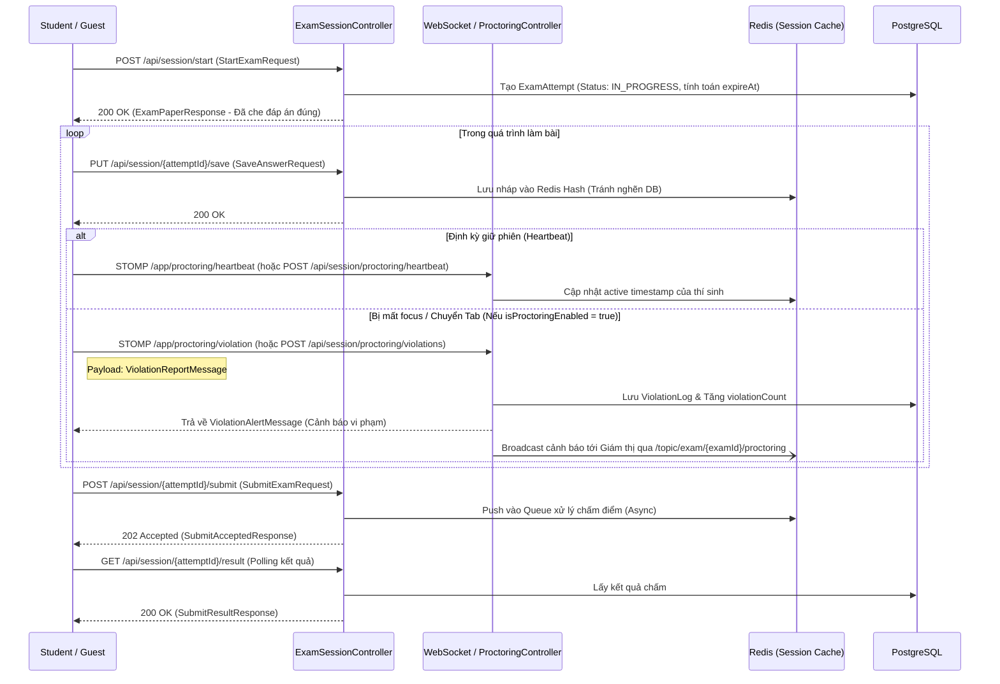
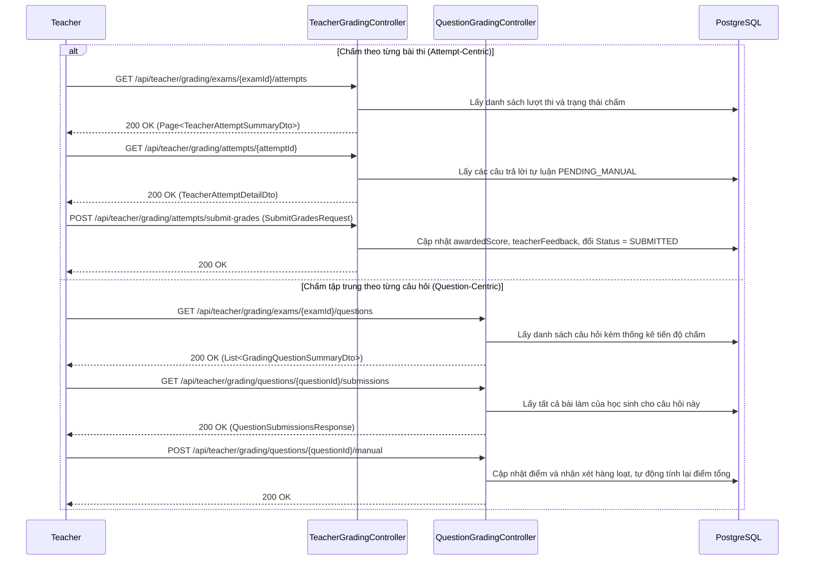
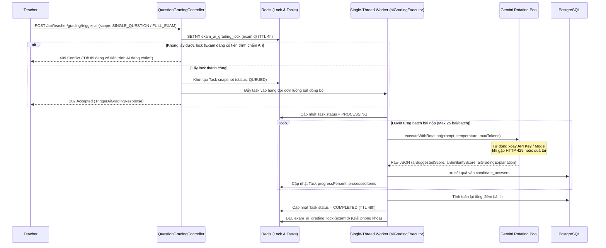
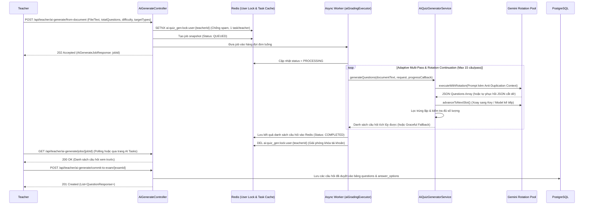
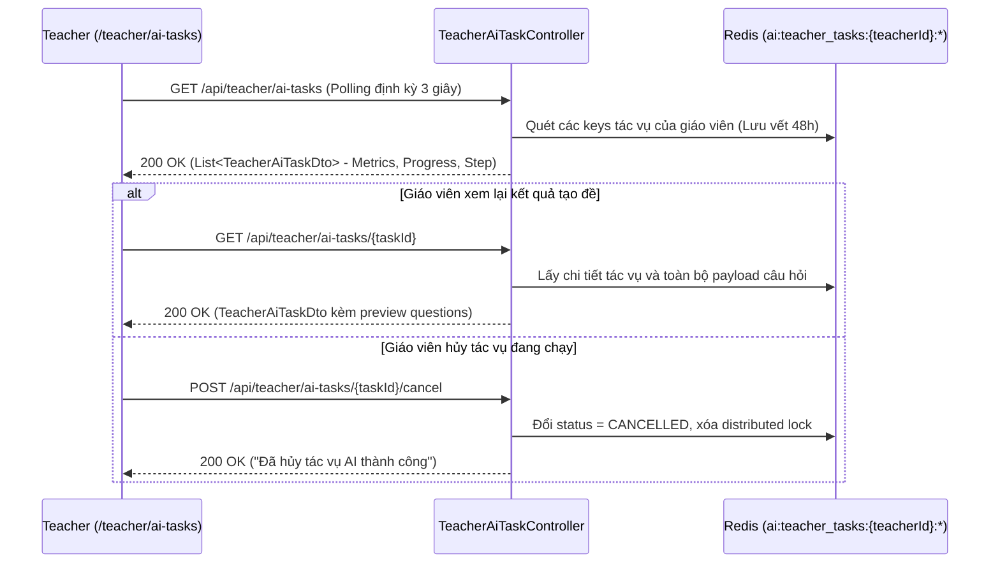
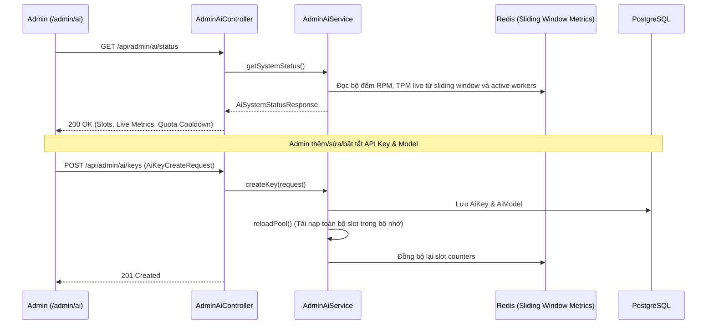
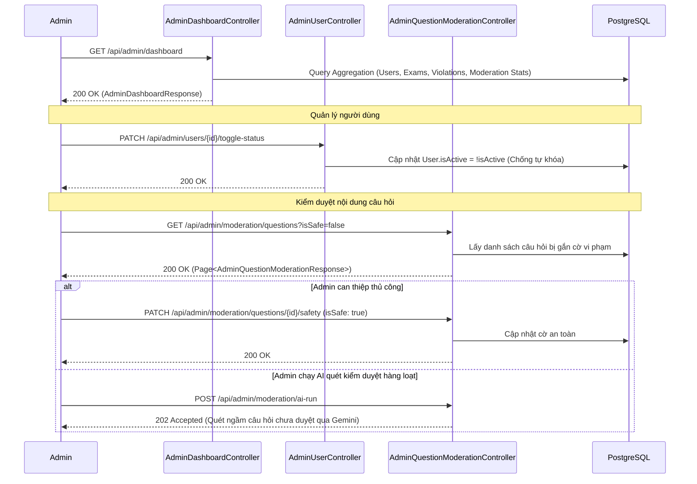

# Tài Liệu Luồng Nghiệp Vụ (System Flows): Hệ Thống Thi Trực Tuyến Quick Test

Tài liệu này mô tả chi tiết các luồng nghiệp vụ dựa CHÍNH XÁC trên các REST API Endpoints, Controllers và logic xử lý hiện tại trong mã nguồn Backend (Spring Boot).

## 1. Luồng Xác Thực và Phân Quyền (Auth Flow)
Ánh xạ theo `AuthController.java` và `AuthService.java`.

---

## 2. Luồng Tạo Đề Thi & Quản Lý Câu Hỏi (Exam Creation & Question Bank)
Ánh xạ theo `ExamController.java` và `QuestionController.java`. Giáo viên tạo đề, cấu hình Proctoring, và lấy câu hỏi từ Question Bank.

---

## 3. Luồng Làm Bài Thi & Giám Sát (Session & Proctoring Flow)
Ánh xạ theo `ExamSessionController.java`, `CandidateProctoringController.java` và `ProctoringWebSocketController.java`.

---

## 4. Luồng Chấm Điểm Tự Luận (Attempt Grading & Question-Centric Grading)
Ánh xạ theo `TeacherGradingController.java` và `QuestionGradingController.java`. Dành cho các câu hỏi dạng `ESSAY_TEXT`.

---

## 5. Luồng Tự Động Chấm Thi Bằng AI (AI Grading via Gemini Rotation Pool)
Ánh xạ theo `QuestionGradingController.java`, `QuestionGradingAsyncWorker.java` và `GeminiRotationService.java`.

---

## 6. Luồng Soạn Đề Thi Bằng AI (AI Document-to-Exam Generation)
Ánh xạ theo `AiGenerateController.java`, `AiQuizGeneratorAsyncWorker.java` và `AiQuizGeneratorService.java`.

---

## 7. Luồng Giám Sát Tác Vụ Ngầm AI Giáo Viên (Teacher AI Tasks Monitor)
Ánh xạ theo `TeacherAiTaskController.java` và `TeacherAiTaskService.java`.

---

## 8. Luồng Quản Trị Hệ Thống AI & Xoay Vòng Khóa (Admin AI Pool Management)
Ánh xạ theo `AdminAiController.java`, `AdminAiService.java` và `GeminiRotationService.java`.

---

## 9. Luồng Quản Trị Hệ Thống & Kiểm Duyệt Câu Hỏi (Admin Management & Moderation)
Ánh xạ theo `AdminDashboardController.java`, `AdminUserController.java` và `AdminQuestionModerationController.java`.

